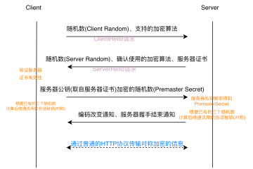

#+TITLE: org-pdf 导出测试
#+AUTHOR: 测试者
#+DATE: 2026-10-15

* 引言 Introduction
这是一个用来测试 *org-pdf* 的文档。它同时包含中文与 English text，
以便检验 /中英混排/ 的断行与字体切换是否正确工作。Let's see if the
Latin runs and CJK runs blend properly on the same line.

** 二级标题 Level Two
正文段落。Emacs 30 的 org-element 会把文档解析成一棵语法树，
我们直接遍历这棵树生成 PDF 绘制指令，完全不依赖 LaTeX。

*** 三级标题
更深一层的标题，字号应当逐级减小。
#+ATTR_ORG: :width 500
#+ATTR_HTML: :width 500

* 列表 Lists
- 无序项一：支持中文
  #+ATTR_ORG: :width 600
  #+ATTR_HTML: :width 600
  
- 无序项二：with English words that should wrap if the line gets long enough to exceed the text width
  - 嵌套项 nested item
  - 另一个嵌套项

1. 有序项一
2. 有序项二
3. 有序项三

* 代码与等宽 Code
下面是一段代码块，应当使用等宽字体并带浅色背景：

#+begin_src elisp
(defun hello (name)
  (message "Hello, %s!" name))
(hello "世界")
#+end_src

行内的 =verbatim= 与 ~code~ 文本也应正确处理。

* 表格 Table
| 姓名 | 年龄 | 说明                   |
|------+------+------------------------|
| 张三 |   28 | 一位很长的说明文字，用来测试单元格换行是否正常工作 |
| Li   |   34 | normal cell            |
| 王五 |   19 | short                  |

* 引用 Quote
#+begin_quote
山重水复疑无路，柳暗花明又一村。

— 陆游《游山西村》
#+end_quote

* 有状态组件
修改src/index.js：
#+begin_src javascript -r
  import React from 'react';
  import { createRoot } from 'react-dom/client';
  import './index.css'

  class App extends React.Component{	(ref:state_component_def)
      //在组件内修改数据，使用state
      constructor(props){	(ref:constructor_of_state_component)
	  super(props)
	  this.state={
	      count:0
	  }

	  setInterval(()=>{
	      this.setState({
		  count:this.state.count+1	(ref:increase_count_by_call)
	      });
	      console.log("count", this.state.count);
	  },1000)
      }
    
      render(){
	  const {count} = this.state;
	  return <h1 className="app">{count}</h1>
      }
  }

  const container = document.getElementById('root');
  const root = createRoot(container);
  root.render(<App />);
#+end_src
注意：
- 有状态组件
  通过[[(constructor_of_state_component)][继承React.Component]]实现。
- 有状态组件
  一定要[[(constructor_of_state_component)][在constructor调用super，并传入props]]。
- 关键代码
  在[[(increase_count_by_call)][设置count增加一]]时，不能写成 =count:this.state.count++= 。因为本身更新count这个操作，需要通过setState方法实现，不能直接自增。写成 =count:++this.state.count= 勉强可以，相当于设置了两遍值。

* 结尾
最后一段。[[www.baidu.com][测试结束]]。Done.
